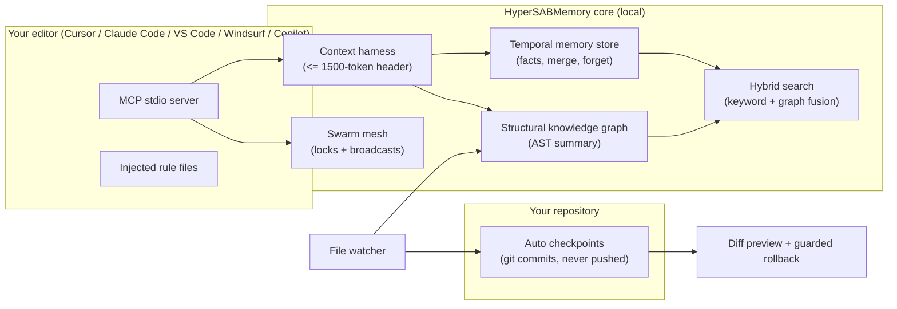

# HyperSABMemory

The first **git-native context harness and memory engine for AI coding agents**.

Agents forget work across chat resets and burn tokens re-reading your repo on every session. HyperSABMemory fixes this at the workspace level: a token-budgeted context header, a local temporal memory store, automatic git checkpoints with safe rollback, and a persistent decision log. Local-first, no telemetry, no cloud.

[](https://opensource.org/licenses/MIT)
[](https://github.com/framesxsab/HyperSABMemory/actions/workflows/ci.yml)
[](https://www.npmjs.com/package/hypersabmemory)


## Why it is different

Most agent-memory tools store chat facts in a cloud or a sidecar database. HyperSABMemory treats the *workspace itself* as the memory:

| Capability | What you get |
|---|---|
| Git-native checkpoints | Automatic snapshots every few minutes while you work, with read-only diff preview and guarded rollback |
| Persistent decision log | Dated decisions, bug facts, and architecture notes that survive across sessions and IDEs |
| Token-ceiling context block | A hard 1500-token budget on injected context, enforced by tests |
| Structural knowledge graph | AST-level map of your codebase so agents reuse existing components instead of rewriting them |
| Swarm coordination | File locks and broadcasts for parallel subagents working the same repo |

Nothing here requires an account, an API key, or network access after install.

## Install in any project

Requires Node 20+.

```bash
npx hypersabmemory setup
```

That command:

1. Injects editor rules (`AGENTS.md`, Cursor `.mdc`, `CLAUDE.md`, Copilot, Windsurf) without wiping your existing text
2. Writes MCP configs (`.cursor/mcp.json`, `.mcp.json`, `.vscode/mcp.json`) and keeps other servers intact
3. Initializes local memory under `.hypersabmemory/`, kept out of your commits automatically via `.git/info/exclude`

Then **reload the IDE** and **enable** the `hypersabmemory` MCP server:

- **Cursor:** Settings > MCP > turn on **hypersabmemory**
- **Claude Code:** `claude mcp add hypersabmemory -- npx -y hypersabmemory mcp`
- **VS Code:** reload; check `.vscode/mcp.json`

MCP-only (no full setup):

```bash
npx hypersabmemory connect
npx hypersabmemory status
```

## Agent tools

| Tool | What it does |
|---|---|
| `hypersabmemory_get_context` | Harness header + Context Block (< 1500 tokens) |
| `hypersabmemory_remember` | Save a decision / architecture / bug fact |
| `hypersabmemory_query` | Search active memories |
| `hypersabmemory_forget` | Invalidate a fact (dropped from Context Block) |
| `hypersabmemory_context_block` | Packed dated facts for the prompt |
| `hypersabmemory_inject_adapters` | Re-sync native rule files |
| `hypersabmemory_checkpoint` | Git snapshot of the working tree |
| `hypersabmemory_broadcast` | Share a finding with parallel subagents |
| `hypersabmemory_claim_task` | Acquire/release an exclusive file lock |
| `hypersabmemory_sync_swarm` | Pull live locks + broadcasts + your session id |

## Everyday commands

```bash
npx hypersabmemory watch --interval 3    # file watcher + periodic checkpoints
npx hypersabmemory watch --dashboard     # watcher + live dashboard in one process
npx hypersabmemory dashboard             # dashboard only - http://127.0.0.1:4321 (localhost only)
npx hypersabmemory checkpoint "reason"   # manual snapshot
npx hypersabmemory history -n 10         # list recent checkpoints
npx hypersabmemory diff <hash>           # preview what a rollback would change (read-only)
npx hypersabmemory rollback <hash>       # safety-checkpointed reset to a checkpoint hash
npx hypersabmemory remember "fact"       # save a memory from the terminal
npx hypersabmemory list -q "search"      # list / recall active memories
npx hypersabmemory forget <id>           # invalidate a memory by id
npx hypersabmemory doctor                # read-only health check (git, store, MCP configs)
npx hypersabmemory publish               # real pre-flight release checks (tree, dist, version)
npx hypersabmemory mcp                   # stdio MCP server (used by the IDE)
```

The live dashboard shows a token meter for the context block, the structural graph state,
memory-store status, and a git checkpoint timeline with 1-click rollback.
It binds to `127.0.0.1` only.

Checkpoints stay **local**. HyperSABMemory never runs `git push`.

## Benchmarked in the open

Recall is gated by a local benchmark (`npm run eval`) with published thresholds and
deterministic fixtures. No hosted numbers, no cherry-picking: CI runs the same gate on
every push.

| Gate | Threshold |
|---|---|
| Active-fact recall | >= 0.80 required |
| Forgotten-fact leaks into results | must be 0 |
| Forgotten-fact leaks into Context Block | must be 0 |
| Retrieval paths gated | direct engine, keyword index, fused memory+graph |
| Header size under worst-case state | <= 1500 tokens enforced |

The fixture includes both active and deliberately forgotten facts, so invalidation is
tested, not assumed. Run it yourself:

```bash
npx hypersabmemory eval
```

```text
HyperSABMemory - local benchmark report

  [PASS] direct-engine       recall 100.0%  forgotten-leaks 0  context-block-leaks 0
  [PASS] keyword-bm25        recall 100.0%  forgotten-leaks 0  context-block-leaks 0
  [PASS] fused-memory-graph  recall 100.0%  forgotten-leaks 0  context-block-leaks 0

Verdict: all 3 retrieval paths passed (threshold 0.8).
Token economics: 381 delivered / 1790 naive corpus tokens (78.7% saved, ratio 0.213)
```

Achieved recall above is on the deterministic fixture (CI runs the same numbers).
The token-economics line is measured against your workspace's own memory store:
the injected context block is hard-capped (~400 tokens) while the raw fact corpus
grows unbounded, so savings climb as your store matures. Use `--json` for
machine-readable output.

## Architecture



## Positioning

HyperSABMemory is local-first infrastructure, not a hosted memory API. If you want a
cloud memory layer for chat products, look at mem0 or Zep. If you want your coding
agent to stop re-learning your repo every session, with checkpoints you can roll back,
this is built for that.

## Develop this repo

```bash
git clone https://github.com/framesxsab/HyperSABMemory.git
cd HyperSABMemory
npm install
npm test
npm run eval
npm run build
```

CI runs the full matrix (Ubuntu + Windows, Node 20/22) plus the recall gate on every push. See [CONTRIBUTING.md](./CONTRIBUTING.md).

Blueprint docs: [Architecture.md](./Architecture.md), [PRD.md](./PRD.md), [Rules.md](./Rules.md), [Phases.md](./Phases.md).

## Privacy

Default is **local-first**: memory lives in `.hypersabmemory/` and your own git history.
No telemetry. No outbound calls after install. The dashboard binds to `127.0.0.1` only.

## License

MIT © [framesxsab](https://github.com/framesxsab)
