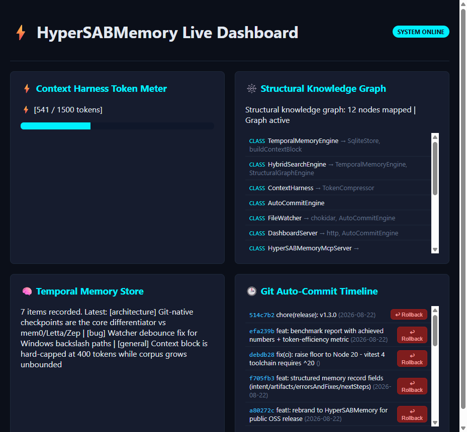
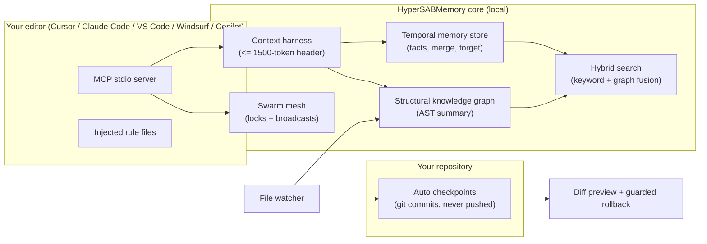

# HyperSABMemory

The first **git-native context harness and memory engine for AI coding agents**.

Agents forget work across chat resets and burn tokens re-reading your repo on every session. HyperSABMemory fixes this at the workspace level: a token-budgeted context header, a local temporal memory store, automatic git checkpoints with safe rollback, and a persistent decision log. Local-first, no telemetry, no cloud.

[](https://opensource.org/licenses/MIT)
[](https://github.com/framesxsab/HyperSABMemory/actions/workflows/ci.yml)
[](https://www.npmjs.com/package/hypersabmemory)



## Why it is different

Most agent-memory tools store chat facts in a cloud or a sidecar database. HyperSABMemory treats the *workspace itself* as the memory:

| Capability | What you get |
|---|---|
| Git-native checkpoints | Automatic snapshots every few minutes while you work, with read-only diff preview and guarded rollback |
| Persistent decision log | Dated decisions, bug facts, and architecture notes that survive across sessions and IDEs |
| Token-budgeted context block | A 1,500-token estimate limit on injected context, enforced by tests |
| Structural graph support | Uses externally generated graph artifacts when available; it does not index source code itself |
| Swarm coordination | File locks and broadcasts for parallel subagents working the same repo |
| Multi-engine safe | MCP servers, dashboard, and CLI share one store through a file-lock CAS — no last-writer-wins memory loss |

Automatic checkpoints stage all trackable changes at the repository root. Review your ignore rules for secrets and generated files before enabling them.

Nothing here requires an account, an API key, or network access after install.

## Install in any project

Requires Node 20+.

```bash
npx hypersabmemory setup
```

That command:

1. Writes local MCP configs (`.cursor/mcp.json`, `.mcp.json`, `.vscode/mcp.json`) keeping existing servers intact, and preserves existing Git-tracked instruction files (`AGENTS.md`, `CLAUDE.md`, `.windsurfrules`, `.github/copilot-instructions.md`, etc.) by default unless `--inject-tracked` is explicitly passed; untracked or new workspaces receive managed harness rules without overwriting custom text
2. Initializes local memory under `.hypersabmemory/`, kept out of your commits automatically via `.git/info/exclude`
3. Seeds first-boot facts from your README, package.json, and git history without creating a Git commit. Pass `--checkpoint` to opt into one initial local checkpoint; in a fresh Git repository it also records the `GENESIS <hash>` baseline.

Then **reload the IDE** and **enable** the `hypersabmemory` MCP server:

- **Cursor:** Settings > MCP > turn on **hypersabmemory**
- **Claude Code:** `claude mcp add hypersabmemory -- npx -y hypersabmemory mcp`
- **VS Code:** reload; check `.vscode/mcp.json`

MCP-only (no full setup):

```bash
npx hypersabmemory connect
npx hypersabmemory status
```

## Agent tools

| Tool | What it does |
|---|---|
| `hypersabmemory_get_context` | Harness header + Context Block (< 1500 estimated tokens) |
| `hypersabmemory_remember` | Save a decision / architecture / bug fact |
| `hypersabmemory_query` | Search active memories |
| `hypersabmemory_query_evidence` | Retrieve bounded recorded memories and hash-checked source excerpts; unsupported relationships remain unresolved |
| `hypersabmemory_forget` | Invalidate a fact (dropped from Context Block) |
| `hypersabmemory_context_block` | Packed dated facts for the prompt |
| `hypersabmemory_inject_adapters` | Re-sync native rule files |
| `hypersabmemory_checkpoint` | Git snapshot of the working tree |
| `hypersabmemory_broadcast` | Share a finding with parallel subagents |
| `hypersabmemory_claim_task` | Acquire/release an exclusive file lock |
| `hypersabmemory_sync_swarm` | Pull live locks + broadcasts + your session id |
| `hypersabmemory_task_grounded_query` | Search task source references and verify supported exact claims against captured hashes |

Resource-aware clients can also pull the context block and memory log passively via MCP resources (`resources/list` + `resources/read`).

For projects that want agents to check prior decisions and unfinished tasks when resuming work, see the [opt-in agent handoff guide](docs/AGENT_HANDOFF.md), and see [Known Limitations](docs/KNOWN_LIMITATIONS.md) for current verification scope and non-guarantees.

The grounded task query takes a `taskId` and `query`, with optional `conflictingPaths`. It can retrieve bounded excerpts for natural questions and verify explicit symbol definitions, exact quoted source text, and uniquely stated top-level JSON scalar values directly from captured task sources, even without a separate memory record. Response-only `source_ref:` identifiers represent those references, not persisted memories. Natural-question results are candidate evidence, not proven claims. Sources are checked against captured hashes; conflicting hashes block assertions, and changed sources must be re-read and explicitly checkpointed.

Retrieval can use static relative imports in indexed JavaScript or TypeScript record text as ranking hints between existing lexical candidates. Those links reflect the recorded text, not a verified current dependency graph; grounded evidence still requires source-hash checks.

Symbol verification accepts complete questions such as `Where is createTask defined?`, `Where is the function createTask() defined?`, and `Which file defines TaskLedger?`, as well as backtick-quoted identifiers. Compound and negated questions do not qualify for a symbol assertion.

Task-grounded responses include `requirements` for requested implementation, test, interface, configuration, and decision roles. Missing roles trigger a subject-focused search within matching captured sources. Candidate lists contain current, hash-checked sources; if no candidate is found, up to five `unrankedReferences` are offered as unverified navigation leads. A role remains `unresolved` until an agent verifies that a source actually supports the question.

Lexical search splits code identifiers and normalizes English word forms with Porter stemming, so terms such as `validate` and `validation` can match. Exact identifier/path priorities and literal assertion verification continue to use the original text. Stemming is a retrieval heuristic and can also increase unrelated candidate matches.

### Evidence query

Use `hypersabmemory_query_evidence` with a natural project question and optional result limit from 1 to 5. The response separates recorded memory from current source excerpts and includes source paths, hashes and line positions when available. Only the existing deterministic verifier can mark an assertion supported; retrieved text by itself does not establish a relationship or implementation compliance.

## Everyday commands

```bash
npx hypersabmemory watch --interval 3    # file watcher + periodic checkpoints
npx hypersabmemory watch --dashboard     # watcher + live dashboard in one process
npx hypersabmemory dashboard             # dashboard only - http://127.0.0.1:4321 (localhost only)
npx hypersabmemory checkpoint "reason"   # manual snapshot
npx hypersabmemory history -n 10         # list recent checkpoints
npx hypersabmemory diff <hash>           # preview what a rollback would change (read-only)
npx hypersabmemory rollback <hash>       # safety-checkpointed reset to a checkpoint hash
npx hypersabmemory remember "fact"       # save a memory from the terminal
npx hypersabmemory list -q "search"      # list / recall active memories
npx hypersabmemory forget <id>           # invalidate a memory by id
npx hypersabmemory handoff               # paste-ready session brief (--story for a retrospective)
npx hypersabmemory doctor                # read-only health check incl. live MCP launch handshake
npx hypersabmemory remove                # clean uninstall: injected sections, MCP entries, store
npx hypersabmemory publish               # real pre-flight release checks (tree, dist, version)
npx hypersabmemory mcp                   # stdio MCP server (used by the IDE)
```

The live dashboard shows a token meter for the context block, the structural graph state,
memory-store status, swarm mesh activity (locks + broadcasts), and a git checkpoint timeline
with 1-click rollback. It binds to `127.0.0.1` only.

Checkpoints stay **local**. HyperSABMemory never runs `git push`. If your current edits
overlap files from a rolled-back checkpoint, the harness appends a single `[GHOST]` warning
to the context header (opt out with `HYPERSABMEMORY_GHOST_PATHS=off`).

## Benchmarked in the open

Recall is gated by a local benchmark (`npm run eval`) with deterministic fixtures.
The repository-grounded baseline (`npm run build && npm run eval:baseline`) reports
precision/recall@5, stale-memory leaks, p50/p95 query latency, corpus size, and estimated
header size; its distractors are synthetic, so it is not a real-user study. See
[V2_BASELINE.md](./docs/V2_BASELINE.md) for the current measured run.

| Gate | Threshold |
|---|---|
| Active-fact recall | >= 0.80 required |
| Forgotten-fact leaks into results | must be 0 |
| Forgotten-fact leaks into Context Block | must be 0 |
| Retrieval paths gated | direct engine, keyword index, fused memory+graph |
| Header size under worst-case state | <= 1500 estimated tokens enforced |

The fixture includes both active and deliberately forgotten facts, so invalidation is
tested, not assumed. Run it yourself:

```bash
npx hypersabmemory eval
```

```text
HyperSABMemory - local benchmark report

  [PASS] direct-engine       recall 100.0%  forgotten-leaks 0  context-block-leaks 0
  [PASS] keyword-bm25        recall 100.0%  forgotten-leaks 0  context-block-leaks 0
  [PASS] fused-memory-graph  recall 100.0%  forgotten-leaks 0  context-block-leaks 0

Verdict: all 3 retrieval paths passed (threshold 0.8).
Token economics: 381 delivered / 1790 naive corpus tokens (78.7% saved, ratio 0.213)
```

Achieved recall above is on the deterministic fixture. CI runs this gate inside its blocking test job.
The token-economics line is measured against your workspace's own memory store:
the injected context block is capped at an estimated ~400 tokens while the raw fact corpus
grows unbounded, so savings climb as your store matures. Use `--json` for
machine-readable output.

## Architecture



## Positioning

HyperSABMemory is local-first infrastructure, not a hosted memory API. If you want a
cloud memory layer for chat products, look at mem0 or Zep. If you want your coding
agent to stop re-learning your repo every session, with checkpoints you can roll back,
this is built for that.

## Develop this repo

```bash
git clone https://github.com/framesxsab/HyperSABMemory.git
cd HyperSABMemory
npm install
npm test
npm run eval
npm run build
```

The CI workflow is configured for Linux, Windows, and macOS on Node 20 compatibility and Node 22/24 LTS lanes. The recall gate runs in the blocking test job. See [CONTRIBUTING.md](./CONTRIBUTING.md).

Blueprint docs: [Architecture.md](./Architecture.md), [PRD.md](./PRD.md), [Rules.md](./Rules.md), [Phases.md](./Phases.md).

## Privacy

Default is **local-first**: memory lives in `.hypersabmemory/` and your own git history.
No telemetry. No outbound calls after install. The dashboard binds to `127.0.0.1` only.

## License

MIT © [framesxsab](https://github.com/framesxsab)
